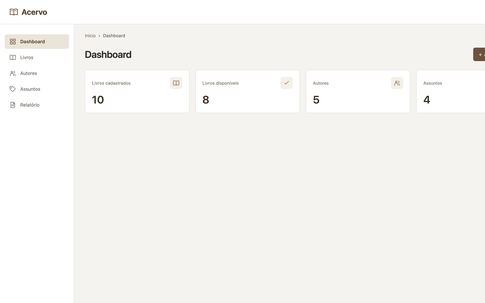

# Acervo

Cadastro de livros, autores e assuntos, com relatório por autor em HTML e PDF.

PHP 8.2, Symfony 7.4, Twig, Doctrine DBAL, MariaDB 10.11, Bootstrap e Dompdf.



## Executar com Docker

```sh
cp .env.local.example .env.local
```

Configure `APP_SECRET` e `DB_PASSWORD` e inicie os serviços:

```sh
docker compose --env-file .env.local -f compose.avaliacao.yaml up -d --build
```

O ambiente usa a porta 8080, configurável por `APP_PORT`. O banco é inicializado na primeira execução.

## Testes

```sh
docker compose --env-file .env.local -f compose.avaliacao.yaml exec app vendor/bin/phpunit
```

## Banco

Os scripts estão em [sql](sql). A ordem de execução está em [ordem.txt](sql/ordem.txt).

Livros aceitam vários autores e assuntos. Cadastros vinculados não podem ser excluídos. O relatório consulta a view `vw_livros_por_autor`.

Mais detalhes em [instalação](docs/implantacao.md) e [visão técnica](docs/apresentacao.md).
